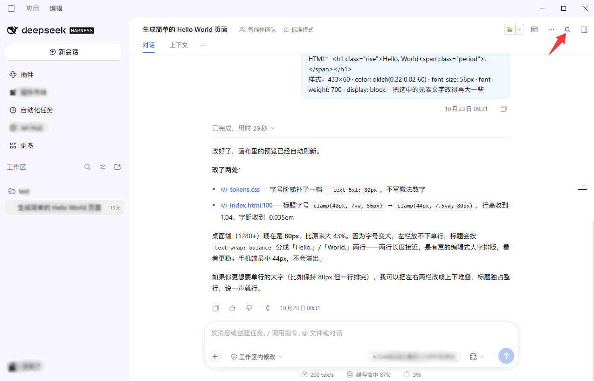
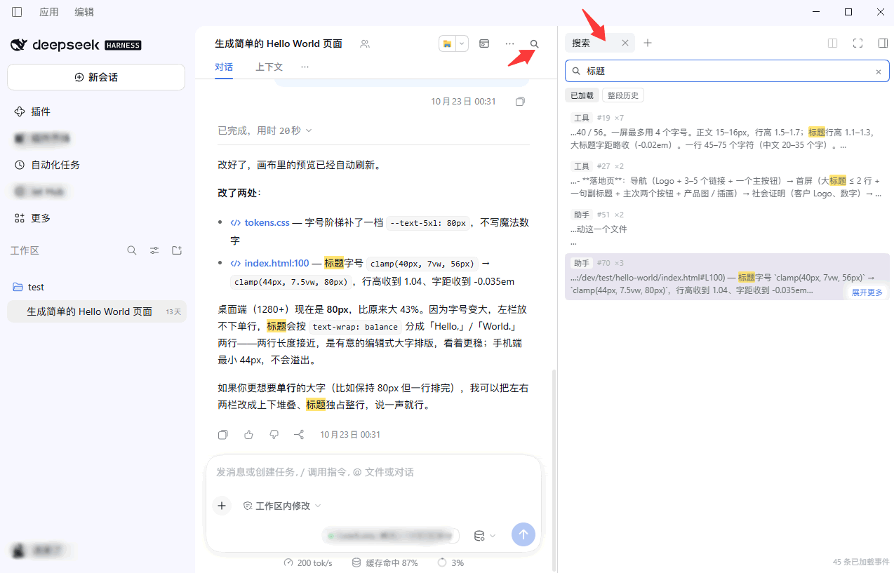
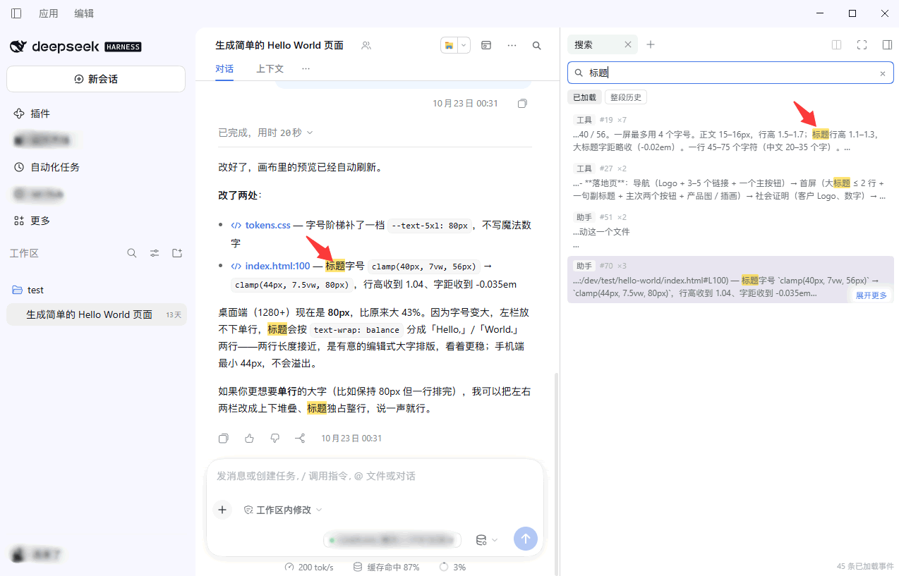
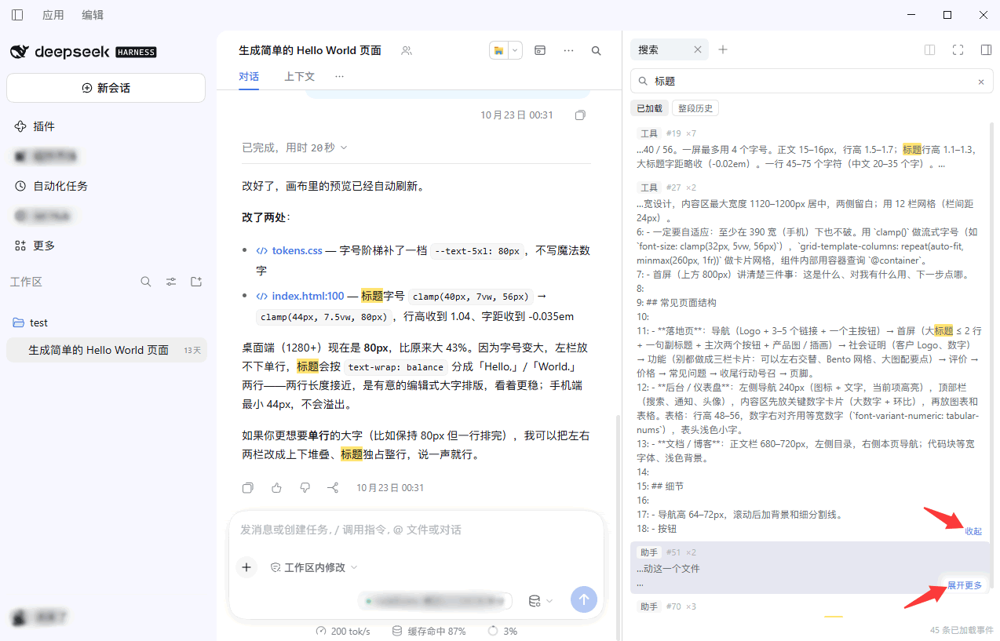

# dsh-content-search (Conversation search)

English | [中文](README.md) | [Changelog](CHANGELOG.en.md)

Search **the conversation you are looking at** inside DeepSeek Harness. A search button sits at the
conversation header's right side; it opens a search box in the right sidebar, and every occurrence of
the keyword in the conversation gets a **yellow background** — your turns and the model's alike. Click
a result and the conversation scrolls to it.

Searching adds nothing. It turns the conversation that is **already in the log** into something you
can query, so this plugin never touches the conversation window, never appends a session event, and
never edits your patch layer. It does two things: read, and locate.

## Screenshots

**The search button in the conversation header**: it registers into the right-aligned Session
utilities (`conversation.session.header.utilities`, order 15), on the same row as the other Session
tools.



**The search panel in the right sidebar**: type to search; the hit count, the source and the range
toggle all live on one screen.



**The yellow keyword highlight**: drawn with `::highlight(dsh-content-search)` over the rendered rows,
user messages and assistant replies alike.



**Hover a result and 「Show more」 floats at its bottom-right**: one click adds roughly 300 characters on
each side, and the link becomes 「Show less」.



## What it does

| Ability | Notes |
| --- | --- |
| Search button | Right side of the conversation header. When the panel is already open, clicking **focuses and expands** the column instead of opening a second one |
| Search box in the right sidebar | Opens as a real sidebar **tab** (type `contentSearch`) and is remembered per session |
| Two ranges | "Loaded" = the window the conversation currently holds, client-side and instant. "Full history" = the whole durable log |
| Yellow highlight | Every occurrence in the conversation gets a yellow background; user and assistant turns are treated identically |
| Jump to a hit | Click a result: history pages to that entry, the row is scrolled into view and washed with a soft yellow that fades after 2 s |
| Selectable text | Each row is a `div role="button"`, not a `<button>`, so its text can be dragged over and copied |
| Show more context | Hovering floats 「Show more」 at the row's bottom-right; a click reveals roughly 300 extra characters on each side |
| Keyboard | `Enter` jumps to the first result, `↑`/`↓` move between results, `Esc` clears |
| Bilingual | Namespace `content-search`, follows the interface language |

## Installation

**Requirements:** DSH >= 0.1.6-alpha.1 and < 0.3.0 (tested on 0.2.1-rc.5). DSH itself requires
Node.js >= 24.2.0 and Git >= 2.31.0.

**Desktop:** install from inside the app (the Desktop profile is managed exclusively by Electron, so
`dsh plugin --profile desktop` is rejected).

- From the plugin page: **Plugins** in the sidebar → **Add** in the top right → provide the source https://github.com/appthin/dsh-content-search.git ;
- Or ask the assistant to call `plugin_manager`'s `install_bundle` with the absolute path of this directory.

**web / tui and other profiles:**

```sh
# A local directory (linked, so edits take effect immediately — good for development)
dsh plugin --profile web add file:E:/dev/deepseek_harness/dsh-content-search

dsh plugin --profile web ls                        # list installed plugins
dsh plugin --profile web remove dsh-content-search # uninstall
```

After installing, open **Plugins → dsh-content-search**; the card should carry the title and
description from `locale/*.json`'s `meta`.

### Updating

Change the code **at the same path**, then `remove_bundle` + `install_bundle` hot-updates it with no
restart.

> **Moving the plugin directory requires a desktop restart.** The Host caches each loader entry's
> resolved client path ("negative verdicts remain stable until restart"). After a move the old path is
> still cached, and the symptom is "installed, but the button is gone". This plugin hit exactly that
> while being built: moving it from a subdirectory to the workspace root made all three seats vanish.
> There are two ways out — restart the desktop app, or **rename the package** (the package name is the
> loader name, and only a changed name is resolved afresh). Renaming takes effect immediately.

### Removing everything

```sh
dsh plugin --profile web remove dsh-content-search
```

The plugin writes no profile files, installs no dependencies and never touches `cordis.patch.yml`, so
removing it is enough.

## Where it lives on screen

- **The button**: `conversation.session.header.utilities`, order 15. This seat allocates its own
  position and spacing, which is why it is used instead of `shell.overlay` — measuring other plugins'
  DOM to estimate a placement is not allowed.
- **The panel**: a tab in the right sidebar, through the documented two-stage registration (the tab
  type into `ctx.sidebarRightTabs`, the body into `sidebar.right.pane.tab`, both under the same id)
  and then `ctx.sidebarRight.openTab(kind)` — the opener expands the column itself. No overlay is
  involved, because "show a search box in the right sidebar" is the right sidebar's own job.

## Two ranges, and the difference is real

| | Loaded | Full history |
| --- | --- | --- |
| Source | The event window the conversation currently holds | Every event in the Host's durable log |
| Implementation | Scanned in the browser | `GET /api/content-search.search` → the Host |
| Latency | Instant | One round trip |
| Cap | 300 results | 200 per page, 1000 in total |
| Touches the conversation | No | No |

**Why not merge them.** "Loaded" costs nothing and answers as you type, so it is the everyday mode.
"Full history" goes through the Host and is slower, but it reaches content the conversation window does
not hold at all. The default stays on "Loaded"; switching is a deliberate act. Making the slow path the
default would charge a network round trip to every search.

**Why full history scans the log instead of using the full-text index.** See below.

## Full history: why not the full-text index

The Host ships a full-text index (`sessionQuery.searchEvents`): fast, cursor-paged, complete. But it
**can be switched off** — a deployment that configures the index with `openAt: "never"` throws
`SESSION_QUERY_SEARCH_DISABLED` on every call. This plugin hit that message in a live test, which is
why the implementation looks the way it does.

It uses `sessionQuery.filterEvents` instead: the inherited, **switch-free** scan that folds a
session's complete committed log into semantic documents and filters them with a literal,
case-insensitive, whitespace-tolerant predicate. Nothing in the configuration can turn it off, and
every document carries the event's **full semantic text** — which is what makes 「Show more」 possible
without a second round trip per hit.

The trade-off is that each search is a full literal scan, so the first page is slower than the index on
very large sessions. That trade is deliberate: **being able to find it** matters more than **finding it
fast**, and on some deployments the index simply does not exist.

## The Host half does exactly one thing the browser cannot

The browser half owns the button, the panel and the jumping. The Host half has a single
responsibility — reading the Session's complete durable log — exposed to the browser through one
**read-only** route:

```
GET /api/content-search.search?sessionId=…&query=…&limit=…&cursor=…
```

- Read-only: it never writes, never activates an Agent, never loads anything into the conversation.
- 100 hits per page by default, 300 at most; the cursor is a **decimal offset**, passed back verbatim
  to page further.
- Each hit carries **roughly 480 characters on each side** of the keyword, enough for the panel to
  expand by some 300 without another request.
- On failure it answers with the Host's own reason (such as the `openAt: "never"` message above), and
  the panel shows that text rather than swallowing it into a generic error.

## How the yellow highlight is drawn

With the **CSS Custom Highlight API** (`CSS.highlights`), never by touching the conversation's DOM:

```js
registry.set('dsh-content-search', new Highlight(...ranges))
```

```css
::highlight(dsh-content-search) { background-color: rgba(255, 206, 0, .55); color: inherit }
::highlight(dsh-content-search-hit) { background-color: rgba(255, 206, 0, .18) }
```

Wrapping matches in `<mark>` would mean editing another plugin's DOM. The highlight also covers only
rows that are **actually rendered**, so a match inside folded content is not lit up out of nowhere —
it is not on the page to begin with.

## How the jump works

1. `session.loadThrough(hit.seq)` pages history to the entry's position (the Host's public loader).
2. The Chat snapshot supplies the nearest node whose `anchorSeq <= hit.seq`.
3. The row is found in the flow through its rendering attributes (`data-chat-node-key` →
   `data-chat-anchor-key` → prefix → `data-chat-turn`).
4. It is centred in the viewport and washed with a soft yellow that fades after 2.2 s.

That step depends on Chat's **rendering contract** (those `data-chat-*` attributes), which is a
rendering convention rather than public API. So the whole path feature-detects and degrades: when no
row is found it says "scrolled to the position, but this entry is not rendered right now" instead of
pretending it worked.

## Layout

```
index.js           Host half: registers the read-only search route, reads the Host log
client.js          Browser half: button, panel, highlight, jump (lazy-CJS, no build step)
cordis.patch.yml   Bundle patch: inserts the loader entry
locale/zh.json     Chinese dictionary and plugin metadata
locale/en.json     English dictionary and plugin metadata
icon.svg           Icon
```

## Known limits

- **Only the current session.** Cross-session search is a different feature (DSH's own workspace search
  lists sessions, but cannot jump to a message).
- **Full history is a literal scan.** The first page is slower on large sessions; no fuzzy matching, no
  tokenizing, no regex.
- **Each hit's context window is ±480 characters.** The 300-character expansion is sliced from that
  window, not re-read from the source.
- **The highlight only covers rendered rows.** Content folded away (`hidden="until-found"`) is not
  force-revealed.
- **Streaming can briefly duplicate a row** while the same seq is still a transient block.
- **The jump depends on Chat's rendering contract.** If upstream changes those `data-chat-*`
  attributes, the jump degrades to "scrolled there but not rendered".
- **The Host log must be readable.** When the Host search route is unavailable the panel shows the
  Host's own message and falls back to 「Load older content」 to widen the window (at most 2 times, 5 s
  timeout each).

## Verifying

```sh
node --check index.js
node --check client.js
```

Then, in the interface:

1. A magnifier appears at the conversation header's right side.
2. Clicking it shows a 「Search」 tab in the right sidebar (if it is already open, it is focused and expanded).
3. Typing a keyword turns every occurrence yellow in the conversation, user and assistant turns alike.
4. Clicking a result scrolls the conversation there with a brief yellow wash.
5. Hovering a result floats 「Show more」 at its bottom-right; clicking adds roughly 300 characters on
   each side and the link becomes 「Show less」.
6. Switching to 「Full history」 makes the note line report where hits come from (the complete log) and
   the count switch to 「hits in the whole history」.

## License

This plugin's code is MIT. It contains no third-party code, bundles no third-party binaries and adds no
dependencies. The icon is drawn for this plugin (`icon.svg`, follows `currentColor`).
