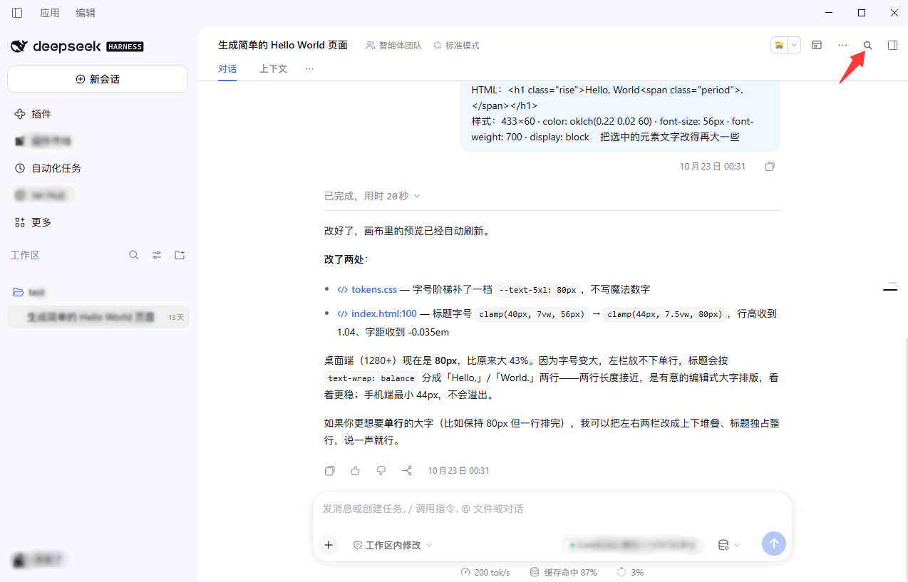
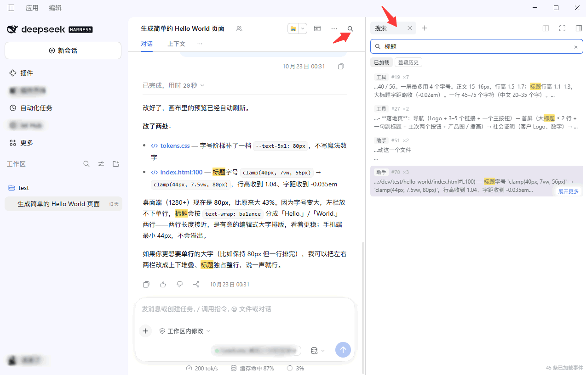
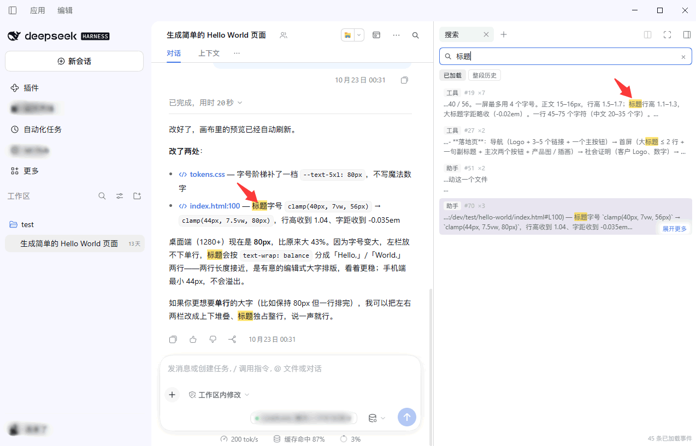
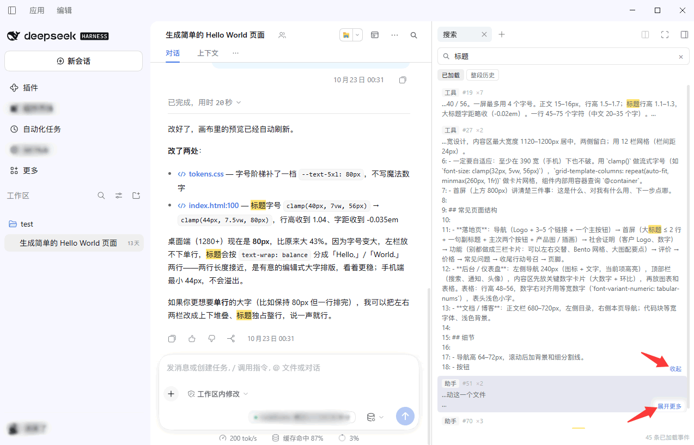

# dsh-content-search (对话内容搜索)

[English](README.en.md) | 中文 | [更新日志](CHANGELOG.md)

在 DeepSeek Harness 里**搜索当前这段对话**：对话区右上角一个搜索按钮，点开在右边栏出搜索框，
敲关键词，对话区里所有命中的字都变成**黄色底色**——包括你发的和模型回的。
点一条结果，对话就滚到命中那一条并落个淡黄底。

搜索本身不产生新东西，它只是把**已经写进日志的对话**变成可检索的。所以这个插件不碰对话窗口、
不写会话事件、不改你的补丁层，只做两件事：读，和定位。

## 截图

**对话区右上角的搜索按钮**：放进头部右侧工具区（`conversation.session.header.utilities`，
order 15），和其他会话工具同一行。



**右边栏的搜索面板**：输入即搜，命中条数、来源与范围切换都在同一屏里。



**关键词黄色高亮**：`::highlight(dsh-content-search)` 画在已渲染的行上，用户消息与助手回复同样处理。



**悬停结果项，右下角浮出「展开更多」**：点一下前后各多 300 字左右，链接变「收起」。



## 功能

| 能力 | 说明 |
| --- | --- |
| 搜索按钮 | 对话区头部右侧；已开着该面板时点击会**聚焦并展开**右边栏，而不是再开一个 |
| 右边栏搜索框 | 作为右边栏的一个**正式标签页**打开（类型 `contentSearch`），会随会话被记住位置 |
| 两种范围 | 「已加载」＝对话当前持有的那一段，纯前端、即时；「整段历史」＝宿主日志全量 |
| 黄色高亮 | 对话区里所有命中的字加黄色底，用户消息与助手回复一视同仁 |
| 命中定位 | 点结果 → 把历史翻到那条 → 滚到该行 → 落一个淡黄底，2 秒后淡出 |
| 可选中复制 | 每条结果是 `div role="button"` 而非 `<button>`，文字可以拖选、复制 |
| 展开更多上下文 | 悬停时右下角浮出「展开更多」，点击前后各多 300 字左右 |
| 键盘 | `Enter` 跳到第一个结果，`↑`/`↓` 在结果间移动，`Esc` 清空 |
| 中英双语 | 命名空间 `content-search`，跟随界面语言 |

## 安装

**版本要求：** DSH >= 0.1.6-alpha.1 且 < 0.3.0（已在 0.2.1-rc.5 上测试）。DSH 自身依赖 Node.js >= 24.2.0 与 Git >= 2.31.0。

**Desktop：** 在应用内安装（Desktop 的 profile 由 Electron 独占管理，`dsh plugin --profile desktop` 会被拒绝）。

- 插件页安装：侧栏 **插件** → 右上角 **添加** → 填入来源 https://github.com/appthin/dsh-content-search.git ；
- 或在会话里让助手调 `plugin_manager` 的 `install_bundle`，目标填本目录绝对路径。

**web / tui 等 profile：**

```sh
# 本地目录（link 方式，改动即时生效，适合开发调试）
dsh plugin --profile web add file:E:/dev/deepseek_harness/dsh-content-search

dsh plugin --profile web ls                        # 查看已装
dsh plugin --profile web remove dsh-content-search # 卸载
```

装完打开 **插件 → dsh-content-search**，卡片上应有标题与描述（`locale/*.json` 的 `meta`）。

### 更新

在**同一路径**下改动后，`remove_bundle` + `install_bundle` 即可热更新，不必重启。

> **改了插件目录路径，必须重启桌面端。** 宿主会缓存每个 loader 条目已解析的客户端路径
> （"negative verdicts remain stable until restart"），换目录后旧路径还在缓存里，
> 表现为「插件装了、按钮没了」。这个插件开发时就撞上过：把目录从子目录挪到工作区根，
> 三个席位全部消失。解决办法只有两个——重启桌面端，或**改包名**（包名即 loader 名，
> 名字变了才会重新解析）。改包名可以立即生效。

### 卸干净

```sh
dsh plugin --profile web remove dsh-content-search
```

插件不写任何 profile 文件、不装依赖、不改 `cordis.patch.yml`，移除即清除。

## 界面在哪

- **按钮**：`conversation.session.header.utilities`，order 15。选这里而不是 `shell.overlay`，
  因为那个席位自带位置与间距，不需要去量别的插件占了多宽——按约定，读另一个插件的 DOM
  来估算摆放位置是被禁止的。
- **面板**：右边栏的一个标签页。走的是官方的两步注册（标签类型进 `ctx.sidebarRightTabs`，
  标签体进 `sidebar.right.pane.tab`，两者用同一个 id），再用 `ctx.sidebarRight.openTab(kind)`
  打开——打开的接口会自己展开右边栏。没用浮层，因为「在右边栏显示搜索框」本来就是右边栏的活。

## 两种范围，区别是真区别

| | 已加载 | 整段历史 |
| --- | --- | --- |
| 数据来源 | 对话当前持有的事件窗口 | 宿主日志的全量事件 |
| 实现 | 浏览器内直接扫 | `GET /api/content-search.search` → 宿主 |
| 延迟 | 即时 | 一次网络往返 |
| 上限 | 结果 300 条 | 每页 200 条，累计 1000 条 |
| 会不会改对话 | 不会 | 不会 |

**为什么不把两种合成一种。** 「已加载」是零成本、只要输入就能出结果的，日常用它；
「整段历史」要走宿主、慢一些，但能看到对话窗口里根本没有的内容。默认停在「已加载」，
需要全量时再切——把慢的那条设成默认，等于每次搜索都先付一次网络代价。

**为什么整段历史走日志扫描，而不是全文索引。** 见下节。

## 整段历史：为什么不用全文索引

DSH 的宿主有一个全文索引服务（`sessionQuery.searchEvents`）：快、游标分页、功能齐全。
但它**是可以被关掉的**——部署把索引配成 `openAt: "never"` 时，每次调用都抛
`SESSION_QUERY_SEARCH_DISABLED`。本插件正是在实测里撞到这句报错，才有了现在的实现：

改用 `sessionQuery.filterEvents`——继承来的、**不带开关**的扫描：把会话完整日志折算成
语义文档，用字面、大小写不敏感、空白宽松的谓词过滤。它没有配置项能关掉它，
而且每份文档带着事件的**完整语义文本**——这一点顺带解决了「展开更多上下文」：
不必为每一条命中再向宿主多要一次文本。

代价是每次搜索是一次全量字面扫描，所以在超大会话上第一页会比索引慢。这是刻意的取舍：
**能搜到**比**搜得快**重要，而索引在有些部署上根本不存在。

## 宿主那半边只做一件浏览器做不到的事

浏览器半边独占按钮、面板、定位。宿主半边只有一个职责：读会话的完整持久日志，
通过一条**只读**路由暴露给浏览器：

```
GET /api/content-search.search?sessionId=…&query=…&limit=…&cursor=…
```

- 只读：不写、不激活 Agent、不往对话里加载任何东西；
- 每页默认 100 条、最多 300 条；游标是**十进制偏移**，原样回传即可翻页；
- 每条命中带回关键词**前后各 480 字左右**的原文，够面板展开到 300 字左右，而不再多跑一趟；
- 失败时把宿主自己的原因原样吐出来（例如上面那句 `openAt: "never"`），
  面板会把它显示在提示行，而不是吞掉换成「出错了」。

## 黄色高亮怎么画的

用 **CSS Custom Highlight API**（`CSS.highlights`），不碰对话的 DOM：

```js
registry.set('dsh-content-search', new Highlight(...ranges))
```

```css
::highlight(dsh-content-search) { background-color: rgba(255, 206, 0, .55); color: inherit }
::highlight(dsh-content-search-hit) { background-color: rgba(255, 206, 0, .18) }
```

为什么不用包一层 `<mark>`：那要改别的插件的 DOM。高亮只覆盖**已经渲染出来的行**，
所以折叠收起的内容里命中的字不会凭空被点亮——它本来就没有出现在页面上。

## 定位是怎么做到的

1. `session.loadThrough(hit.seq)`——把历史翻到这条所在的位置（宿主公开的加载接口）；
2. 从 Chat 快照里挑出 `anchorSeq <= hit.seq` 的最近一个节点；
3. 在对话流里按渲染属性找行（`data-chat-node-key` → `data-chat-anchor-key` → 前缀 → `data-chat-turn`）；
4. 滚到可视区中央，落一个淡黄底，2.2 秒后淡出。

这一步依赖 Chat 的**渲染契约**（那几个 `data-chat-*` 属性），它是渲染约定而非公开 API。
所以全程做了特性检测与降级：找不到行时提示「已翻到该位置，但这一条当前没有渲染出来」，
而不是假装成功。

## 结构

```
index.js           宿主半边：注册只读搜索路由，读宿主日志
client.js          浏览器半边：按钮、面板、高亮、定位（lazy-CJS，无构建步骤）
cordis.patch.yml   bundle patch：插入 loader 条目
locale/zh.json     中文字典与插件元信息
locale/en.json     英文字典与插件元信息
icon.svg           图标
```

## 已知限制

- **只搜当前会话。** 跨会话搜索是另一件事（DSH 自带的工作区搜索能列出会话，但不能跳到某条消息）。
- **整段历史是字面扫描。** 大会话第一页会慢；不做模糊匹配、不分词、不支持正则。
- **每条命中的上下文窗口是 ±480 字。** 展开上限 300 字是从这个窗口里切的，不是重新读原处。
- **高亮只覆盖已渲染的行。** 折叠收起（`hidden="until-found"`）的内容不会被强行点亮。
- **流式回复期间可能出现短暂的重复行**：同一 seq 的临时块在落定前会被算作一条。
- **定位依赖 Chat 渲染契约。** 上游改了那几个 `data-chat-*` 属性，定位会退化成「已翻到但没渲染出来」。
- **宿主日志必须可读。** 宿主日志接口不可用时，面板会显示宿主原话，并退回「加载更早的内容」把窗口撑大（最多 2 次、每次 5 秒超时）。

## 验证

```sh
node --check index.js
node --check client.js
```

界面里依次确认：

1. 对话区右上角出现放大镜按钮；
2. 点击 → 右边栏出现「搜索」标签页（若已存在，会聚焦并展开）；
3. 输入关键词 → 对话区命中的字变黄，用户消息与助手回复都有；
4. 点一条结果 → 对话滚到该位置并短暂泛黄；
5. 悬停一条结果 → 右下角浮出「展开更多」→ 点击后前后各多 300 字左右，链接变「收起」；
6. 切到「整段历史」→ 提示行显示命中来源（整段日志），结果条数变为「条命中（整段历史）」。

## License

本插件代码 MIT。不含任何第三方代码、不打包第三方二进制、不引入任何依赖。
图标为本插件自绘（`icon.svg`，跟随 `currentColor`）。
